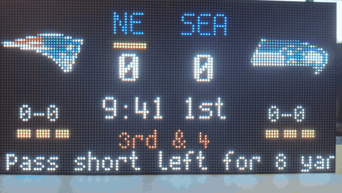

# Game Day Scoreboard

## Credits and thanks

- **Brandon Harvey ([@bharvey88](https://github.com/bharvey88))** started Game Day Scoreboard. Thank you, Brandon, for all the work that went into it, and for releasing it under the MIT license, so everyone can use, change and share it (see [LICENSE](LICENSE)).
- Apollo Automation maintains this fork of the project.
- It is built on [hub75-studio](https://github.com/pavlov-net/hub75-studio)'s LVGL pages and controller packages, and on the attribute model of the [ha-teamtracker](https://github.com/vasqued2/ha-teamtracker) integration. Thanks to both projects.



A standalone scoreboard for HUB75 LED matrix panels. Install it from your browser, join it to WiFi, pick your team on the panel's own web page, and it follows the game from ESPN by itself. Nothing else to run. It covers the NFL, college football, MLB, minor league baseball (Triple-A to Single-A, read from MLB's own stats API, since ESPN doesn't carry it), the NBA, the WNBA, men's college basketball, the NHL, the AHL and the ECHL (read from HockeyTech, the stats service those leagues use), MLS, the Premier League, golf's PGA Tour and LPGA Tour, Formula 1 and the NASCAR Cup Series.

Watch the [full demo](https://apolloautomation.github.io/gameday-scoreboard-main/) on the installer page. The [docs](docs/wiki/src/content/docs/) cover setup, every setting, each sport's board, troubleshooting and running the firmware on your own board.

If you already use Home Assistant and want room lighting to celebrate too, [gameday-matrix](https://github.com/bharvey88/gameday-matrix) does the same thing through a blueprint.

## What it does

- Next-game card while you wait: both logos, season records, the game's day and start time in your timezone, and a ticker with the betting line, over/under, TV network and venue
- Live scoreboard at kickoff: scores, the game clock and quarter in large type under them, down and distance beneath that (red in the red zone), abbreviations in team colors with the team holding the ball in gold, records under the logos, timeout pips, and a scrolling ticker with the down and distance and where the ball is (one switch) and the last play (another); the clock keeps its own row and never goes in the ticker
- Full-screen splashes in the scoring team's color, with its logo and the points it gained, for touchdowns, field goals, extra points, 2-point conversions, safeties, interceptions and fumble recoveries, the opponent's acknowledged in theirs, and a victory splash on a win; each kind has its own switch
- Each sport has its own board: the inning, count, outs and a small diamond of the runners in baseball; the minute, stoppage time, latest goal and red cards in soccer; the period and clock in hockey and basketball, with the playoff series when there is one. Home runs, grand slams, walk-offs, goals and buzzer beaters get the fireworks too, and red cards, late lead changes and overtime get splashes of their own
- Big plays in other games: the panel checks other live games about every 45 seconds and switches to one for its big play, then goes back, never leaving your team's live game unless you allow a favorite's; Follow this game keeps one game on the board instead
- Golf: follow the PGA Tour or the LPGA Tour like a team, with this week's tournament and the top of its leaderboard, and the next event and its days between tournaments
- Racing: follow Formula 1 or the NASCAR Cup Series like a team, with the race weekend's next session and its start time, the latest session's order with car numbers and gaps, the race winner's splash, and the next race between weekends
- Lingers on the final (half an hour, ten minutes for baseball), then looks up the next game
- Live games: follows a random game in progress in the leagues you choose and moves on when it ends, or every 30 seconds to 30 minutes
- An idle display for when none of your games is on (the next game, a clock, today's scores, your team's game today with a countdown, your team's logo big with its next game or last result, or off or dim), and night hours with their own brightness
- College teams' ranks, and a pro team's seed or place in place of its record if you like
- Up to 16 favorite players, with their stat lines in the ticker while they lead their game and their name on the celebration when they score
- Up to eight bets and 16 player props you type in by hand, with whether each is covering or on track during the game and won or lost after, scrolling in green, red or gold; the panel never connects to a sportsbook
- Other displays in place of the scoreboard: F1 (the running order during a session, then the next session's countdown, the circuit, the weather there, both championships and the last race), Stocks & Crypto (up to eight stocks, funds, indexes or coins with their logos, the day's change and chart) and the Flight Tracker (the planes flying near a spot you pick). None needs an account or a key. Stocks & Crypto, the Flight Tracker and F1's schedule and weather fall back to a backup source on their own; F1's running order waits for ESPN
- A device page that mirrors the panel, celebrates with it, lists the next three games in football, soccer, minor league baseball, the AHL and the ECHL, and holds every setting
- Up to 16 favorite teams from any league (not the golf tours or racing series, which can't be favorites yet), cycling through the ones playing today, with the first four on a WizMote remote's numbered buttons
- Updates itself over WiFi from the device page when a new release is out, or on its own between 3 and 5 AM if you turn on Install updates automatically
- Adapts to one 64x64 panel (logos side by side, stacked scores), one 128x64 panel or two to four 64x64 side by side (logos at the edges, big scores, records and pips in the middle), or four 64x64 in two rows of two (the board on top, the time and a bigger ticker underneath); one firmware, the layout is a setting. Three or four panels and two rows of two can show a second area beside the board: the clock, today's scores, a second team's game, other live games or one of the other displays

## Hardware

Building your own? [Runs on your own panel](https://apolloautomation.github.io/gameday-scoreboard-main/diy/) lists the boards and panels it runs on, how to wire a bare ESP32-S3, and what differs from a Game Day Scoreboard.

- The [Apollo Automation M-1 LED Matrix](https://apolloautomation.com/products/m-1-led-matrix) (Rev6), or any ESP32-S3 HUB75 controller on the [MoonHub75](https://github.com/MoonModules/Hardware/tree/main/MOONHUB75) pinout, with 16MB flash, octal PSRAM, and a button on GPIO0 (build `gameday.yaml`). The M-1 Rev6 uses the MoonHub75 pinout, microphone and button pins; the M-1 Rev4 uses other pins and needs its own build
- The scoreboard75 controller board (build `gameday-scoreboard75.yaml`)
- One 64x64 HUB75 panel, a 128x64 display (one 128x64 panel or two 64x64 side by side), three or four 64x64 side by side, or four in two rows of two (one firmware; pick the layout on the device page). With three or four panels Wi-Fi setup is through the hotspot only, and the supply has to be rated for all of them

The MoonHub75 pinout, which the M-1 Rev6 shares, under the names ESPHome uses (that board's README calls the upper half R0/G0/B0):

| R1 | G1 | B1 | R2 | G2 | B2 | A | B | C | D | E | LAT | OE | CLK |
| --- | --- | --- | --- | --- | --- | --- | --- | --- | --- | --- | --- | --- | --- |
| 1 | 5 | 6 | 7 | 13 | 9 | 16 | 48 | 47 | 21 | 38 | 8 | 4 | 18 |

## Install

1. Open the [installer page](https://apolloautomation.github.io/gameday-scoreboard-main/), plug the controller in over USB, and click Install. That page is for the scoreboard75 controller board, which starts on a 128x64 display. Have an Apollo M-1 (Rev6) or another controller on the MoonHub75 pinout? Use the [DIY installer](https://apolloautomation.github.io/gameday-scoreboard-main/install/diy/) instead: it asks whether yours drives one 64x64 panel or a 128x64 display before you click Install, so the first boot uses the right layout.
2. Enter your WiFi details in the dialog that follows the install. If you skip it, the panel starts a hotspot named Game Day plus six letters and numbers, like Game Day 2f6a70, and shows its name and a QR code for it. Point any iPhone or Android camera at the code to join the hotspot, or join it by name from any phone or laptop, and a setup page opens.
3. Once it's on WiFi the panel's QR code opens its own page by IP address, and the panel shows the page's `gameday-xxxxxx.local` name. Scan the code, or open that name on your phone or computer on the same WiFi, and pick your team there, or add the panel to Home Assistant (below). Until you pick a team or a mode, from that page or Home Assistant, the ticker asks you to and gives the panel's IP address for phones that can't resolve `.local` names. Holding the controller's boot button for 1.5 seconds shows the name and the IP address again any time.

From the first Apollo Automation release on, the project's site at that address has the installers and the demo, the DIY, support and changelog pages, and the update feed the panels read. The [docs](docs/wiki/src/content/docs/) are in this repo.

A phone's camera and browser are enough to set a panel up. The QR code is the hotspot's Wi-Fi code whenever the panel is off WiFi and its hotspot is up, during setup and a few minutes into an outage, so a new router or password is fixed the same way. None of it needs the Game Day app, a separate project that Apollo Automation does not maintain, which may not find panels running this firmware; the hotspot and the device page do everything it does.

Team changes take effect immediately and survive reboots. Wrong panel size? Click the matching picture in the Setup card. Nothing needs reflashing to change teams or layouts.

## The device page

The device serves its own page: a live board that mirrors the panel (logos, score, clock, down and distance or the count and outs, timeout pips, last play), a team chooser with logos, search and a tab per league plus an "On now" tab listing today's games from ESPN and MLB (tap the side you want to follow), and the settings grouped in plain language: the ones changed most in a Quick settings card under the board, the rest in cards that fold. It is plain HTML and JavaScript embedded in the firmware, so it works with no internet beyond what your browser reads itself: logos from ESPN, MLB and HockeyTech, the "On now" tab from ESPN and MLB, rosters from ESPN when you add a favorite player or a player prop, and Open-Meteo's place search when you look up the Flight Tracker's home. The page reads one JSON document from the device (`GET /gameday/state`) and writes settings back to `POST /gameday/set`, so it is not limited to what an ESPHome entity can carry.

| Setting | What it does |
| --- | --- |
| Show | My team, Favorite teams, or Live games: a game in progress picked at random from the leagues you choose, switching every 30 seconds to 30 minutes |
| Team | All 32 NFL teams, every FBS college football team, every MLB, NBA, WNBA, NHL, MLS and Premier League team, every Division I men's college basketball team, every Triple-A to Single-A minor league baseball team and every AHL and ECHL team, a tab per league, plus an "On now" tab. The Golf tab has the PGA Tour and the LPGA Tour and the Racing tab Formula 1 and the NASCAR Cup Series, each followed like a team |
| Timezone | Follows the browser's zone unless you pick one by hand; used for game times |
| Ticker: game situation, last play, odds and TV | Choose what scrolls along the bottom. Game situation is down and distance in football, the count and outs in baseball, and goals, cards and stats in soccer |
| Opponent scores too | Turn the opponent's scoring splashes off if you only want yours |
| Favorites | Up to 16 teams in priority order. "Only today's games" keeps the playlist to the favorites playing today. The first four are the numbered buttons on a WizMote remote |
| Remote | Pair a WizMote: turn discovery on, press any button on the remote. ON/OFF, brightness and NIGHT buttons control the panel |
| Panels | One 64x64 panel, one 128x64 panel or two 64x64 side by side, three or four wide, or two rows of two (with how the rows are mounted). Changing it restarts the device after a confirm |
| Firmware / Check for updates | The device checks this project's releases every 6 hours; an Install button appears on the page when a newer version exists and updates over WiFi |
| Install updates automatically | Off unless you turn it on. Installs a new release between 3 and 5 AM, never during a game the panel follows |
| Brightness, Panel on, Ticker speed, Showing | Panel brightness, panel on or off, ticker speed, and the scoreboard, the clock page or another display: F1, Stocks & Crypto or Flight Tracker |
| Refresh scores, Reboot | Re-fetch right away, restart |

## Home Assistant is optional

The device runs on its own, but it is a normal ESPHome device. If Home Assistant is on the same network it discovers the panel under **Settings → Devices & services**; press **Add** and there is no key to enter. Not discovered? Add the ESPHome integration and enter the panel's `gameday-xxxxxx.local` name or IP address:

[](https://my.home-assistant.io/redirect/config_flow_start/?domain=esphome)

It comes with the controls worth automating: Team, Mode, Power, Brightness, Scroll Speed, Select Page, Game Status, Last Play, Firmware, Install Updates Automatically, Refresh Now, Reboot and the WizMote pairing switches. Favorites, timezone, ticker options, splashes and the panel count are set from the device page only. Men's college basketball and minor league baseball teams aren't in Home Assistant's Team list (it would be too long for an entity); pick them on the device page. The API has no encryption key in the prebuilt binary; build from YAML if you want one.

## Build it yourself

```
git clone https://github.com/ApolloAutomation/gameday-scoreboard-main
cd gameday-scoreboard-main/firmware
esphome run gameday.yaml
```

`gameday.yaml` only names the build and picks the controller pin map from `firmware/controllers/`; everything else lives in `gameday-common.yaml`. The panel count is a saved preference applied at boot by `components/panel_layout`, so one binary serves every layout. The scoreboard page is in `pages/gameday-live.yaml`, the ESPN logic in `components/gameday`, and the device web page in `firmware/web` (edit `app.js`, `app.css` or `demo.js`, then run `python3 scripts/build_web.py` to refresh the embedded bundles). The theme and clock packages come from [hub75-studio](https://github.com/pavlov-net/hub75-studio), pinned to a commit.

## How it works

The `gameday` component asks ESPN's public site API for the team's next event, then polls that game's own scoreboard entry, in every league: every 15 minutes while the game is far off, every minute inside the last hour, every 10 seconds during the game, showing ESPN's clock as it arrives, and every minute for half an hour after the final (ten minutes for baseball). After a failed read it waits longer before trying again. The JSON is streamed through a filter on the device so a scoreboard of several hundred kilobytes never has to fit in memory at once. Score deltas between polls decide the splashes, the same rules the blueprint uses. Logos are ESPN's dark-background PNGs (the plain one when a team has no dark version), decoded and shrunk to 32x32 on the ESP32. A golf tour is read differently: ESPN's scoreboard header for the tour (about 19 KB) gives the tournament and the top 25, every minute while a round is played and every 5 minutes between rounds, and after a final the tour's season calendar names the next event. A racing series is read the same way: its scoreboard header lists the race weekend's sessions with each one's order (up to about 95 KB for an F1 weekend), every 30 seconds while a race runs, every minute in practice and qualifying, and closer to each session as it nears. Minor league baseball comes from the MLB Stats API and the AHL and the ECHL from HockeyTech's feed instead, each read, counted and backed off apart from ESPN (see ARCHITECTURE.md).

The parser and game logic have host tests: `make -C tests` (needs g++). The device page has browser tests against a mock of the panel's web server: in `tests/web`, run `npm ci` and `npx playwright install chromium` once, then `npm test` (needs Node and Python 3). To refresh the team list at the start of a season, run `python3 scripts/build_teams.py` and commit the regenerated header.

## Notes

- ESPN's API is unofficial and can change without notice. The device sends a curl-style User-Agent because ESPN's edge rejects unfamiliar ones. The MLB Stats API, which the panel reads for minor league baseball, is public but undocumented in the same way, and so is HockeyTech's feed, which it reads for the AHL and the ECHL with the public site keys the leagues' own websites send (the `hockeytech_*` substitutions in `firmware/gameday-common.yaml`).
- All HTTPS requests (ESPN, logos, firmware updates) are certificate-verified against the ESP-IDF bundle. If ESPN ever moves to a certificate authority outside that bundle, fetches will fail until a rebuild.
- Team logos are ESPN's (minor league baseball teams' are MLB's, AHL and ECHL teams' HockeyTech's) and are fetched at runtime, not bundled. So are the Stocks & Crypto logos, from Parqet, companiesmarketcap.com and Financial Modeling Prep for stocks and funds, and Parqet, the cryptocurrency-icons set on GitHub and CoinCap for coins.
- Fetching runs on its own task, so the panel animation keeps going while a document downloads.

### On your network

The panel is a score display, and it treats your home network as trusted.
Anyone already on your Wi-Fi can open its page and change the team, and
updates are not password protected. That is a deliberate trade: it keeps
setup to a scan of the panel's QR code and keeps the panel working when
your phone is the only thing that knows it exists. It is not designed to
be exposed to the internet, so do not forward a port to it.

## Contributing

Contributions are welcome: bug reports from game days, test fixtures from odd games, builds for new boards and fixes to the device page. [CONTRIBUTING.md](CONTRIBUTING.md#where-help-is-wanted) says where help is wanted and how to build and test. Docs changes go in `docs/wiki` alongside the code they describe.

## License

MIT.
